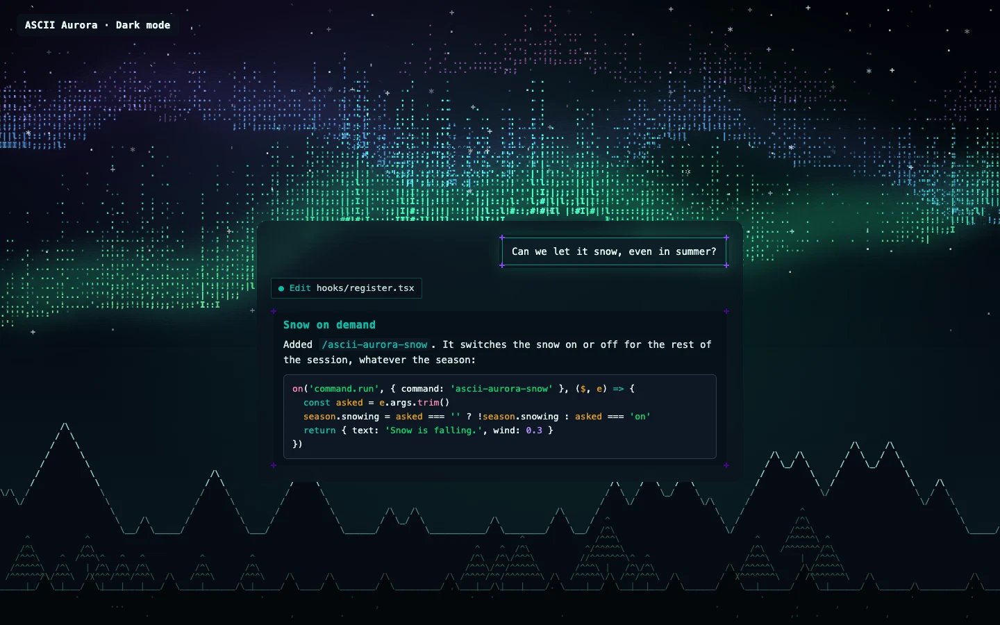
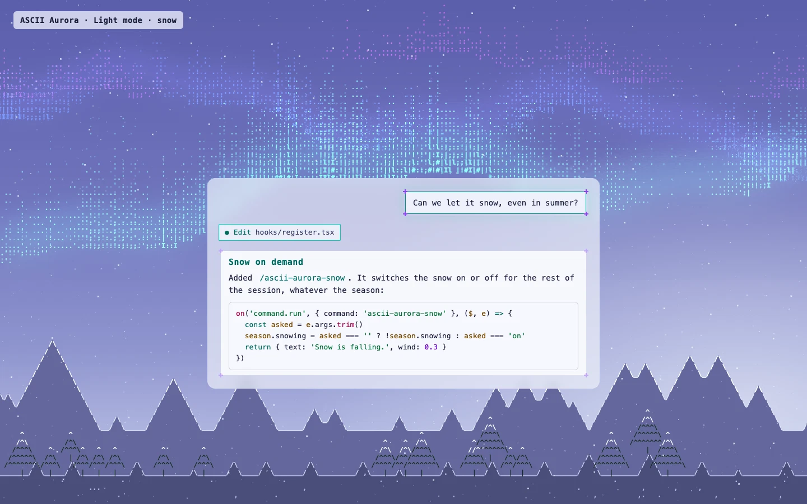
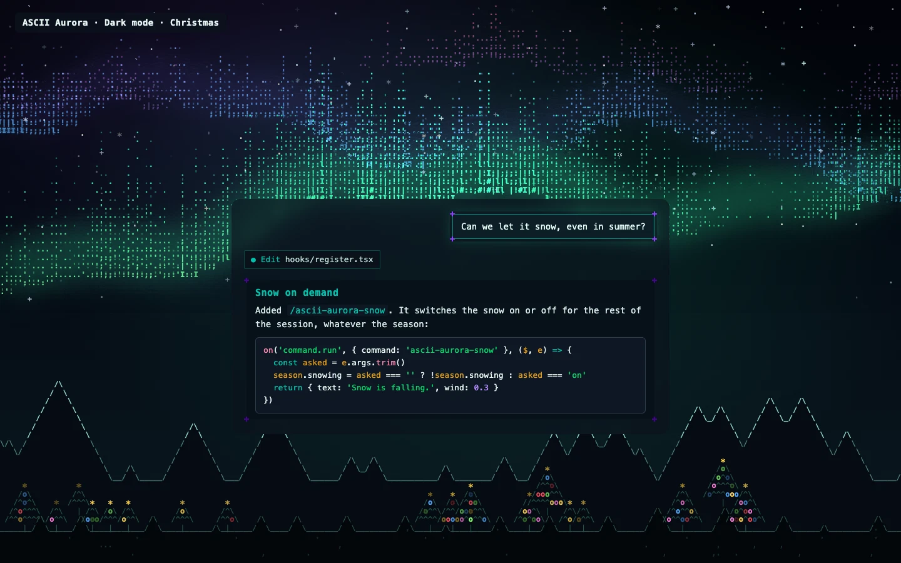
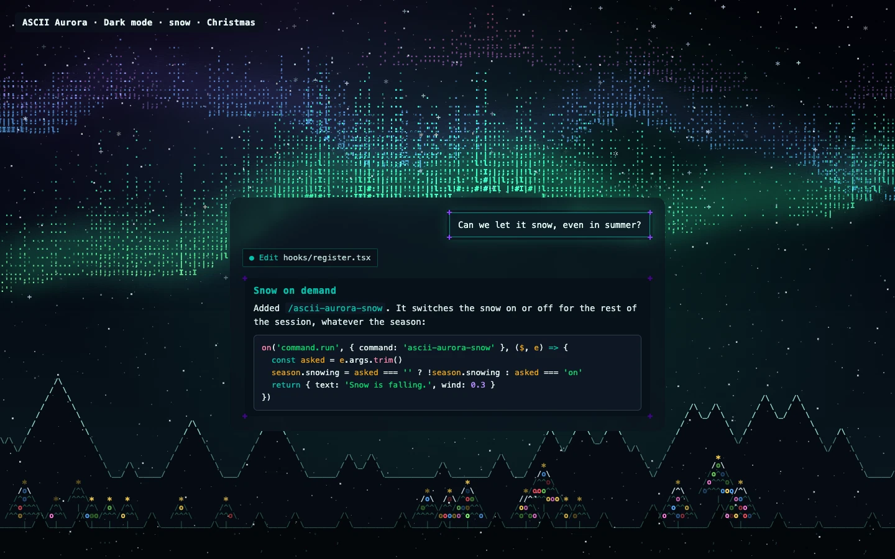
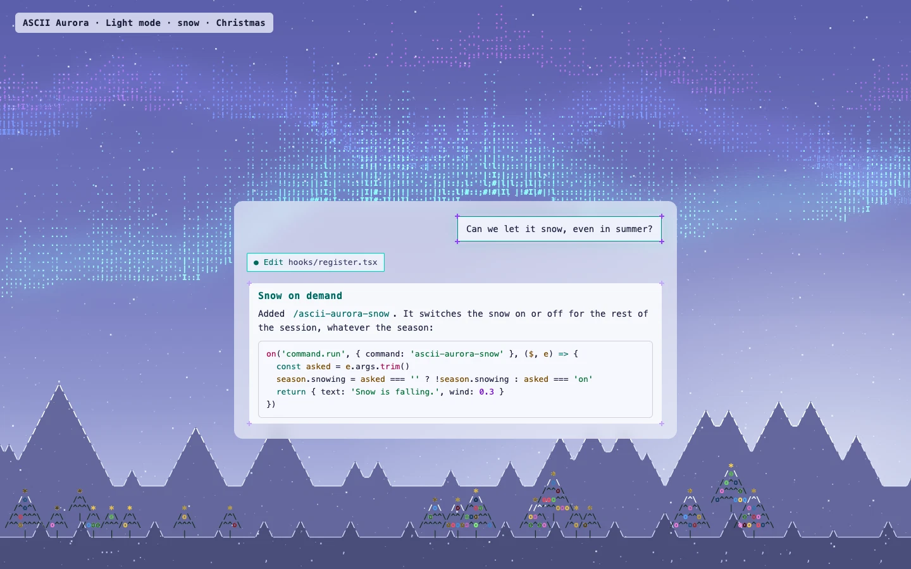

# ASCII Aurora

A theme for the Claude desktop app, built as a Claude Code mod. An aurora
borealis made entirely of ASCII characters sways behind the conversation, over
ASCII mountains and a pine forest: under a starry night sky in dark mode, and
a daytime aurora sky in light mode. Text, code and messages take the aurora's
colours. Snow falls in the cold months, the pines are hung with lights at
Christmas, and an optional ambient sound brings wind, high bells and low notes.



Themes draw in the desktop and mobile apps only. The terminal and editors
ignore them.

## Gallery

|   | Dark mode | Light mode |
| --- | --- | --- |
| **Every day** |  |  |
| **Snow** |  |  |
| **Christmas** |  |  |
| **Snow and Christmas** |  |  |

These are mock-ups, not screenshots of the app. The sky is the real backdrop,
drawn by a WebGL copy of the shader and frozen at one moment. The conversation
in front of it is drawn in the theme's own colours and message styles.

## Install

At the prompt of a Claude Code terminal session:

```
/plugin install ascii-aurora-theme --marketplace iamkevinv/claude-theme-ascii-aurora
```

Answer `y` to add the marketplace, then press Enter to install for your user.

Or from a shell:

```bash
claude plugin install ascii-aurora-theme --marketplace iamkevinv/claude-theme-ascii-aurora
```

In the Claude desktop app, where `/plugin` doesn't run: click **+** next to
the prompt box, then **Plugins**, **Add marketplace** with
`iamkevinv/claude-theme-ascii-aurora`, then **Add plugin**.

Once installed it loads in every new session, desktop app included. To update
to the latest version:

```bash
claude plugin update ascii-aurora-theme@claude-theme-ascii-aurora
```

If you installed it before it was renamed, under the name `ascii-aurora`,
updating won't carry it over. Uninstall the old name and install the new one:

```bash
claude plugin uninstall ascii-aurora@claude-theme-ascii-aurora
```

```bash
claude plugin marketplace update claude-theme-ascii-aurora
```

```bash
claude plugin install ascii-aurora-theme@claude-theme-ascii-aurora
```

## Features

### The sky

- **Three aurora curtains** of `. ' : ; ! | l I #` rays, each in its own
  colour family: green and teal low, cyan and blue above, violet and magenta
  highest. Each has a soft glow beneath it.
- **They move on the GPU.** The sky is drawn once as a still picture, and a
  small shader brings it to life in the desktop app. It tells the curtains
  apart by colour and slides each on its own clock: 34, 43 and 57 seconds each
  way, with the middle one going against the others. Each glides smoothly by
  fractions of a pixel and is resampled sharply, so the characters keep their
  shape and edges.
- **Light on the move.** Each curtain breathes on its own clock and shimmers
  in patches, and a band of light travels along them every 30 seconds.
- **Stars** stay put while the curtains move, each twinkling as a whole on
  its own clock.
- **Mountains and forest:** two ASCII ranges, with snow-lit peaks and a pine
  forest along the near one. They stay still.
- **Still where it should be.** With reduced motion turned on, or on the
  mobile app, the still sky shows on its own.

### Light and dark mode

The theme follows your own light or dark setting.

- **Dark mode** is a polar night: near-black navy surfaces, icy mint text, a
  starry sky and dark green pines.
- **Light mode** is a daytime aurora sky: pale periwinkle surfaces and deep
  indigo text.
  - The sky is periwinkle overhead, lightening to near white at the horizon,
    with a bright glow low on one side.
  - The aurora is laid on as added light, as daytime aurora is, so it shows
    pale and bright in blue-green, light blue and lilac.
  - There are no stars by day. The mountains turn slate with snow-white
    ridges, and the pines a deep evergreen.

### The conversation

- **Your messages** sit in an ASCII box (`+----+`), with teal lines and
  violet corners.
- **Claude's replies** sit on a plain panel, dark or light to match the mode,
  with only the corners marked.
- **Headings** are aurora teal. **Tool calls** sit in teal-edged rows.
- **Message text is monospace.**
- **Code** uses the aurora's colours: teal keywords, green strings, violet
  literals, magenta names and gold variables.
- **Frosted panels:** the app's panels frost over the moving sky, so the words
  stay easy to read.

### Snow

- In the cold months where you are, each session has a **30% chance** of
  light pixel snow falling over the whole scene, in three depths. Further
  flakes are smaller, slower and fainter.
- While it snows, the **top third of every pine is white with snow**: bright
  white by day, and a softer bluish white by night.
- The cold months are November to March in the Northern Hemisphere and May to
  September in the Southern. The hemisphere comes from your computer's time
  zone, so no location is asked for (`hooks/season.js`).

### Christmas

- On **24 and 25 December**, by your computer's own calendar, every pine is
  hung with coloured lights and a gold star. Each bulb glows up and down on
  its own clock.
- The lights go up and come down around midnight, with no reload needed.

### Sound

Off until you press the speaker in the session's title bar.

- **Ambience:** wind over the snow, a high bell now and then like the sky
  crackling, and a low note answering it.
- **Cues:** soft chimes when you send a message, when Claude finishes, when
  it asks you something, and when you click the sky.
- **Wind** has two modes:
  - *Steady* is always there.
  - *Gusty* comes in windy and calm spells of random length, swelling and
    ebbing over 30 to 48 seconds, down to almost nothing between them.

  The wind choice is remembered across sessions.

### Commands

Each command is prefixed with the plugin's name, so none clashes with
another plugin's.

| Command | What it does |
| --- | --- |
| `/ascii-aurora-snow` | Lets it snow, or stops it, for the rest of the session, whatever the season. Add `on` or `off` to set it, or leave it off to switch. |
| `/ascii-aurora-christmas` | Hangs the Christmas lights, or takes them down, for the rest of the session, whatever the date. Add `on` or `off`, or leave it off to switch. |
| `/ascii-aurora-wind` | Switches the wind between steady and gusty. Add `steady` or `gusty` to pick one. |

You can also switch the wind by right-clicking an empty part of the
conversation and choosing **Wind: make it gusty / steady**.

## Files

| File | What it holds |
| --- | --- |
| `.claude-plugin/plugin.json` | The mod's name, version, description, author and licence |
| `.claude-plugin/marketplace.json` | Makes this repository a marketplace, so it installs with one line |
| `.claude-plugin/icon.png` | The plugin's icon, made by `scripts/make-icon.mjs` |
| `hooks/hooks.json` | Points Claude Code at `register.tsx` |
| `hooks/register.tsx` | Palette for both modes, message styles, sound and wind modes, the three commands, the right-click item, the snow roll, the Christmas check, and the backdrop |
| `hooks/scene.js` | Generates the still ASCII sky as one SVG, night and day, with the optional Christmas lights and snow caps. It's seeded, so the sky is the same every time |
| `hooks/aurora-sky.ts` | The GPU shader that animates the sky in the desktop app. `claude plugin validate .` prints its cost |
| `hooks/season.js` | Works out the cold months from the time zone and the month |
| `hooks/make-colors.js` | Turns a few colours into a full palette. It's copied from Claude Code's plugin-authoring skill, with `make-colors.d.ts`: don't edit them, and copy them again when Claude Code updates. They aren't covered by this repository's licence |
| `hooks/*.test.ts(x)` | Tests, run with `claude plugin test` |
| `scripts/preview-scene.mjs` | Writes `preview/scene.svg`, for tuning the sky in a browser |
| `scripts/make-icon.mjs` | Draws the icon (the three curtains as pixel rays inside the message frame) and renders it to `.claude-plugin/icon.png` with headless Chrome |
| `docs/images/` | The gallery above |
| `.claude-plugin/types/` | API types Claude Code writes for editors and `tsc`. Generated, not committed |
| `LICENSE` | The licence: CC BY-NC-SA 4.0 |

## Working on it

```bash
claude plugin validate .
```

```bash
claude plugin test .
```

```bash
node scripts/preview-scene.mjs
```

To run it from a clone of this repository in a terminal session, from the
clone's folder:

```bash
claude --plugin-dir .
```

Or install it from the clone, so Claude Code reads it straight from there and
`/reload-plugins` picks up your edits:

```bash
claude plugin marketplace add .
```

```bash
claude plugin install ascii-aurora-theme@claude-theme-ascii-aurora
```

Things to know when changing it:

- **Sound.** `$.theme.set` rejects sound that is out of range or too long to
  render: each note's attack plus release can be at most 4 seconds. Run the
  tests after changing the sound; they fail with the engine's reason.
- **Curtain colours.** Each curtain keeps to its own range of hues (main 115°
  to 178°, ribbon 182° to 238°, veil 242° to 345°), so the shader can tell
  them apart. A colour outside its range makes that curtain's characters move
  with another's.
- **Under the ridge,** the shader takes anything bright and strongly coloured
  for a Christmas bulb and twinkles it. Keep the ground, mountains and pines
  muted.
- **Experiments.** Earlier shader approaches are kept as tags:
  `experiment/shader-warping` (a wavy ripple that bent the characters) and
  `experiment/shader-rolling` (a lean that rippled like a rolling shutter).

  <details>
  <summary>Trying an experiment</summary>

  To try one in the desktop app, install the plugin from your clone (above),
  then check the tag out there:

  ```bash
  git switch --detach experiment/shader-warping
  ```

  The tags are older than the rename, so the plugin in them is still called
  `ascii-aurora`, and `ascii-aurora-theme` won't load while one is checked
  out. Install it under the old name, then run `/reload-plugins`:

  ```bash
  claude plugin install ascii-aurora@claude-theme-ascii-aurora
  ```

  To go back, switch to main, remove the old name, and run `/reload-plugins`
  again:

  ```bash
  git switch main
  ```

  ```bash
  claude plugin uninstall ascii-aurora@claude-theme-ascii-aurora
  ```

  </details>

## Contributing

Issues and pull requests are welcome. Only the repository's owner can push to
it, so changes come in as pull requests from a fork, and each one is reviewed
before it's merged.

1. Fork the repository and make a branch for your change.
2. Try the change in the desktop app from your fork's folder, as
   [Working on it](#working-on-it) describes, in both light and dark mode.
3. Run `claude plugin validate .` and `claude plugin test .`. Both should
   pass.
4. Open a pull request that says what you changed and why. If it changes how
   the theme looks, add a screenshot.

By opening a pull request, you agree that your contribution is licensed under
the same licence as the rest of the project.

## Licence

ASCII Aurora Theme © 2026 Kevin Vanderbeken is licensed under
[CC BY-NC-SA 4.0](https://creativecommons.org/licenses/by-nc-sa/4.0/). You're
free to share and adapt it for non-commercial purposes, as long as you give
credit and share your changes under the same licence. The full text is in
[LICENSE](LICENSE).

`hooks/make-colors.js` and `hooks/make-colors.d.ts` are copied from Claude
Code's plugin-authoring skill, by Anthropic, and aren't covered by this
licence.
